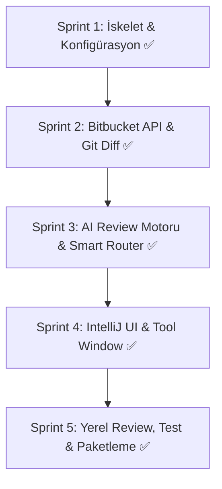

# IntelliJ IDEA AI PR Review Plugin - Sprint Yol Haritası & Mimari Plan

Bu proje, VS Code üzerinde geliştirilen Bitbucket AI PR Review eklentisinin IntelliJ IDEA (JetBrains Platform) ekosistemi için sıfırdan, yüksek performanslı ve kurumsal standartlarda **Kotlin** ile geliştirilmesidir.

---

## 🧠 Model Stratejisi: "Tiered AI Engine" (Karmaşık İşler İçin Güçlü Modeller)

Kullanıcının *"karmaşık işler için daha güçlü modeller kullan"* direktifi doğrultusunda çok katmanlı bir AI orkestrasyon motoru tasarlanmıştır:

| Katman | Görev / İş Yükü Türü | Model Tipi (Örnek) | Neden & Özellik |
| :--- | :--- | :--- | :--- |
| **Tier 1: Hızlı / Triage Katmanı** | Dosya filtreleme, diff boyut analizi, trivial typo kontrolleri, PR metadata özetleme | Hızlı & Düşük Maliyetli (sağlayıcının küçük/hızlı modelleri veya yerel küçük modeller) | Milisaniyeler içinde yanıt, token tasarrufu, ön eleme. |
| **Tier 2: Güçlü / Derin Analiz Katmanı (Complex Engine)** | Güvenlik açıkları (SQLi, XSS, token leakage), concurrency/thread-safety, transaction yönetimi, null-safety, mimari uyum | **En Güçlü Modeller** (sağlayıcının en yetenekli muhakeme/kod modelleri veya yerel büyük modeller) | Geniş context window, karmaşık zincirleme mantık ve derin kod muhakemesi yeteneği. |
| **Dinamik Yönlendirici (Smart Router)** | Diff boyutu, değişen dosya türleri (`.kt`, `.java`, `.sql`, config) ve karmaşıklık sinyallerine göre diff parçalarını otomatik olarak uygun modele sevk eder. | Heuristic Classifier & Rules | Kritik dosyalar (Auth, Payment, Service, Security) otomatik olarak Güçlü Modele yönlendirilir. |

---

## 🚀 Sprint Durumu & Çıktıları

### 📋 Sprint 1: Mimari Kurulum, Proje İskeleti & Konfigürasyon (TAMAMLANDI)
- [x] Hedef dizin (`ykb-pr-review-intellij`) oluşturulması
- [x] Gradle Kotlin DSL (`build.gradle.kts`, `settings.gradle.kts`, `gradle.properties`, `gradlew.bat`)
- [x] `plugin.xml` manifest yapılandırması (IntelliJ 2023.2+ - 2024.3+ uyumlu)
- [x] `PersistentStateComponent` tabanlı kalıcı ayarlar servisi (`ReviewSettingsState.kt`)
- [x] IntelliJ Preferences (`Settings -> Tools -> YKB AI Review`) ayar ekranı (`ReviewSettingsConfigurable.kt`, `ReviewSettingsComponent.kt`)

### 📋 Sprint 2: Bitbucket Entegrasyonu & Git Diff İşleme (TAMAMLANDI)
- [x] Bitbucket Server / Data Center REST API Client (Bitbucket Cloud desteklenmez) (`BitbucketClient.kt`, `BitbucketModels.kt`)
  - PR Listesi çekme (`/pull-requests`)
  - PR Diff çekme (Raw diff / unified diff)
  - Inline yorum ve genel özet yorumu gönderme
- [x] Diff Filter (`DiffFilter.kt`): Binary, lock ve minified dosyaları eleme, hassas token/key maskeleme
- [x] Diff Chunker (`DiffChunker.kt`): Büyük diff'leri bağlam ve karmaşıklık seviyesine göre parçalama

### 📋 Sprint 3: AI Review Motoru, Çok Katmanlı Model Mimarisi & Prompting (TAMAMLANDI)
- [x] Çoklu LLM Provider Desteği (`LLMClient.kt` - OpenAI/Azure/Anthropic/Ollama uyumlu `/chat/completions`)
- [x] **Smart Model Router** (`SmartModelRouter.kt`): Karmaşık ve güvenlik kritik dosyaları güçlü modellere (Tier 2), rutin değişiklikleri hızlı modellere (Tier 1) yönlendirme
- [x] İki Katmanlı Güvenli Prompt Şablonu (`ReviewPrompt.kt`: `<untrusted_diff>`, katı JSON şeması, prompt injection koruması)
- [x] JSON Parser (`ReviewParser.kt`), Hata Kurtarma & Sonuç Birleştirici (`ReviewMerger.kt`)
- [x] İnceleme Orkestratörü (`ReviewCoordinator.kt`)

### 📋 Sprint 4: IntelliJ UI (Tool Window, Diff & Editor Entegrasyonu) (TAMAMLANDI)
- [x] JetBrains Tool Window (`ReviewToolWindowFactory.kt`, `ReviewPanel.kt`)
  - Aktif repo PR listesi, filtreler, arama
  - Tek tıkla "AI İncelemesi Başlat" butonu ve ilerleme çubuğu (`ProgressIndicator`)
- [x] Review Sonuç Ekranı:
  - Severity etiketleri (`high`, `medium`, `low`), hata türleri (`bug`, `security`, `performance` vb.)
  - Geliştirici için aksiyon butonları: "Bitbucket'a Gönder", "Koda Git", "Yoksay"
  - Çift tıklama ile ilgili dosya ve satıra doğrudan IDE editöründe gitme (`navigateToSource`)
- [x] Markdown Yorum Formatlayıcı (`CommentFormatter.kt`)

### 📋 Sprint 5: Yerel Ön İnceleme (Local Pre-Commit), Testler & Dağıtım (TAMAMLANDI)
- [x] Yerel Git Uncommitted / Staged değişiklikleri inceleme (`LocalReviewAction.kt`)
- [x] Kapsamlı Birim Testleri:
  - `SmartModelRouterTest.kt`: Triage vs Complex model yönlendirme doğrulaması
  - `DiffFilterTest.kt`: Dosya eleme ve secret maskeleme doğrulaması
  - `ReviewParserTest.kt`: Markdown-wrapped JSON ve fallback testi
- [x] Kapsamlı Proje Dokümantasyonu (`README.md`)
